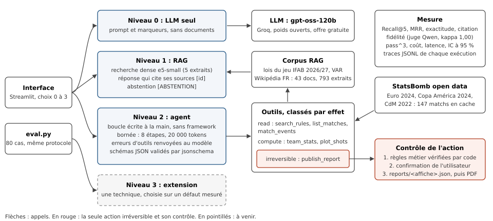

<!-- Gabarit : python scripts/build_report.py remplace les balises {{...}} par les résultats mesurés,
     puis produit docs/rapport/rapport.pdf. Les passages marqués [À COMPLÉTER] restent à écrire. -->

## 1. Cas d'usage

Un analyste de football répond aux questions d'arbitrage (lois du jeu IFAB 2026/27) en citant ses sources, s'abstient quand les documents ne contiennent pas la réponse, et prépare un rapport d'avant-match à partir des données StatsBomb (Euro 2024, Copa América 2024, Coupe du monde 2022). La publication du rapport est la seule action irréversible : elle passe par des règles métier vérifiées par du code, puis par la validation de l'utilisateur.

## 2. Architecture

Chaque niveau expose `answer(question) -> Result` : l'interface et `eval.py` ne lisent que ce format commun. Abstention, demande de précision et refus sont signalés par des marqueurs fixes détectés par du code. La boucle de l'agent est écrite à la main, sans framework.

## 3. Choix justifiés par des mesures

{{choix}}

## 4. Protocole et résultats

{{protocole}}

{{table_qualite}}

{{table_couts}}

{{comparaison}}

[À COMPLÉTER après les mesures finales : lecture du tableau en trois phrases, ce que chaque niveau apporte et ce qu'il coûte.]

## 5. Robustesse et sécurité

{{robustesse}}

{{injection}}

## 6. Analyse de cinq échecs

[À CONFIRMER sur les mesures finales, avec l'identifiant de la trace de chaque échec.]

1. **L'agent reformule ses recherches en anglais** (niveau 2) : « maximum number of players a team can have on the field ». Le premier extrait pertinent descend dans le classement (Recall@5 0,70 contre 1,00 au niveau 1 sur les mêmes cas). Cause : le modèle traduit la question avant d'appeler `search_rules`. Piste : imposer la langue de la requête ou la réécrire.
2. **Refus au lieu d'abstention** (absent-04, niveau 1) : sur l'indemnité de transfert, le modèle répond `[REFUS]` (hors sujet) au lieu de `[ABSTENTION]` (absent des documents). La frontière entre les deux marqueurs est floue pour le modèle.
3. **Réponse fidèle mais incomplète** (doc-18) : sur les décisions examinées par la VAR, les deux modèles décrivent les décisions factuelles et subjectives sans nommer but, penalty et carton rouge. Les mots clés attendus manquent alors que la réponse est soutenue par les extraits.
4. **Panne du système, corrigée** : le modèle a appelé `search_rules` avec `k=10` alors que le schéma impose 8 au plus ; l'API a refusé l'appel (erreur 400) et l'évaluation s'arrêtait. L'erreur est maintenant renvoyée au modèle, qui corrige ses arguments.
5. **Limite de la mesure** (doc-17) : une citation Wikipédia correcte est comptée comme fausse parce que le cas n'attend que la loi IFAB. La métrique de citation sous-estime légèrement les niveaux 1 et 2.

## 7. Limites et coût

{{couts}}

- Petits effectifs : avec 40 cas doc, un cas pèse 2,5 points ; les intervalles de confiance sont donnés et les comparaisons sont appariées.
- L'exactitude est vérifiée par mots clés ; la fidélité par un juge calibré sur 30 annotations humaines (accord 30/30), dont 10 erreurs injectées assez nettes.
- La possession est estimée par la part des passes, pas par la possession officielle.
- Les lois de l'IFAB ne sont pas redistribuées : le corpus se reconstruit par script.
- Quota gratuit de 200 000 tokens par jour : l'évaluation complète est étalée sur plusieurs jours (`eval.py --resume`).

[À COMPLÉTER : extension retenue et son effet mesuré contre le niveau 2.]
