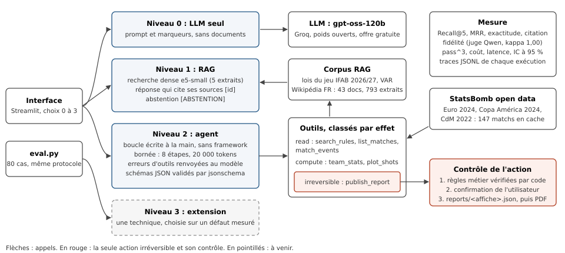

# Sections de Simon : cas d'usage, architecture, choix, évaluation, extension

Les balises {{...}} sont remplies par `python scripts/build_report.py` depuis `results/`.

## Cas d'usage

Un analyste de football répond aux questions d'arbitrage (lois du jeu IFAB 2026/27) en citant ses sources, s'abstient quand les documents ne contiennent pas la réponse, et prépare un rapport d'avant-match à partir des données StatsBomb (cinq compétitions de sélections, 262 matchs). La publication du rapport est la seule action irréversible : elle passe par des règles métier vérifiées par du code, puis par la validation de l'utilisateur.

## Architecture

Chaque niveau expose `answer(question) -> Result` : l'interface et `eval.py` ne lisent que ce format commun. Abstention, demande de précision et refus sont signalés par des marqueurs fixes détectés par du code. La boucle de l'agent est écrite à la main, sans framework.

## Choix justifiés par des mesures

{{choix}}

## Protocole et résultats

{{protocole}}

{{table_qualite}}

{{table_recherche}}

{{comparaison}}

Le RAG apporte la citation des sources et l'abstention (0,30 à 0,90), sans gain d'exactitude : le modèle connaît déjà les lois du jeu. L'agent est le seul à réussir les tâches (0,25 à 1,00) et répond plus juste, pour 5,5 fois plus de tokens ; en contrepartie il classe moins bien le bon extrait (MRR 0,54 contre 0,75) et traite mal les demandes ambiguës. Le niveau 3 corrige ce dernier défaut sans régression fiable ailleurs.

## Extension : planification

**Défaut mesuré.** Au niveau 2, les demandes ambiguës tombent sous le LLM seul. La lecture des échecs montre un mécanisme unique : l'agent appelle un outil avant de décider si la demande est claire, puis lève lui-même l'ambiguïté avec le match le plus récent, jusqu'à publier un rapport sur une affiche qu'il a choisie.

**Technique.** Planifier puis exécuter : un appel au modèle, sans outils, décide (précision, refus ou exécution) et liste les étapes dont les arguments sont connus. Une précision ou un refus part aussitôt, avec un marqueur posé par le code. Sinon le code exécute les étapes prévues, puis la boucle du niveau 2 termine, inchangée. Une règle métier refuse `publish_report` si le plan n'a pas prévu cette affiche.

**Mesure.** Protocole fixé avant d'écrire le code : 30 cas ambigus (les 10 du jeu de test et 20 nouveaux, relus avant toute mesure), 3 essais par cas, score d'un cas égal à la part de ses essais réussis.

{{ambigus}}

Les tâches sont déjà à 1,00 au niveau 2 : le gain ne peut se lire que sur ces cas, et sur l'absence de régression. Abstention, succès des tâches et pass^3 sont inchangés ; l'exactitude passe de 0,95 à 1,00 sans que l'écart soit fiable. Le coût augmente de 3 % en tokens et de 0,7 s : un cas ambigu ne demande plus qu'un appel au modèle (1,8 au niveau 2), mais une tâche en demande 3,7 contre 3,55, le plan n'économise donc rien sur les tâches.

**Ce qui a échoué.** La première version du plan réglait les cas ambigus (1,00) mais faisait chuter l'abstention de 0,90 à 0,20 : elle refusait les questions de football absentes des documents au lieu de chercher puis de s'abstenir. La règle a été corrigée une fois, après lecture de ces cas ; la correction est donc vérifiée sur 10 cas absents nouveaux, jamais utilisés pour régler le plan ({{absents}}). Autre effet observé : avec le plan, l'agent appelle moins d'outils et complète parfois de mémoire (task-19 cite un score de tirs au but qu'aucun outil n'a renvoyé).

## Robustesse et sécurité

{{robustesse}}

Le RAG est le niveau fragile aux reformulations : la recherche perd des extraits pertinents sur les questions familières ou avec fautes. L'agent les absorbe en reformulant lui-même ses requêtes. {{injection}} Aucune publication n'a lieu sous l'effet d'une consigne injectée.

## Limites de l'évaluation

- Petits effectifs : 10 cas absents et 10 cas ambigus dans le jeu principal, donc un cas vaut 0,10. Les intervalles sont donnés, les comparaisons sont appariées, et les deux critères ont été remesurés sur des jeux complémentaires.
- L'exactitude est vérifiée par mots clés ; la fidélité par un juge d'une autre famille de modèles, calibré sur 30 annotations humaines dont 10 erreurs injectées assez nettes.
- Le prompt du plan a été réglé une fois sur les cas absents du jeu principal : ces 10 cas ne sont plus une preuve neutre pour le niveau 3.
- Les réponses varient d'un essai à l'autre malgré la température 0 : 13 cas ambigus sur 30 ne donnent pas le même résultat à leurs 3 essais au niveau 2.
